<!--
  Profile README for github.com/Gatimuvictor
  Graphics in assets/ and generated/ are vector SVGs built by
  .github/workflows/profile-cards.yml (refreshed every 6 hours).
-->

<picture>
  <source media="(prefers-color-scheme: dark)" srcset="./assets/header-dark.svg">
  <source media="(prefers-color-scheme: light)" srcset="./assets/header-light.svg">
  
</picture>

  
   
  
  

## About me

- 🏢 **Founder of [VictordevTech LTD](https://victordevsystems.com)**, a software company building enterprise systems
- 🔭 I build ERP, POS, finance, HR/payroll and integration platforms
- 🐘 Backend: **Laravel (PHP)** and **Django (Python)** with REST APIs
- 🗄️ Full database administration: design, tuning, backup and recovery, replication, security
- 📊 **Microsoft Dynamics 365 Business Central**: AL extensions, APIs and integrations
- 📫 Reach me: **gatimujohn98@gmail.com**

## What I build

<picture>
  <source media="(prefers-color-scheme: dark)" srcset="./assets/expertise-dark.svg">
  <source media="(prefers-color-scheme: light)" srcset="./assets/expertise-light.svg">
  
</picture>

## Tech stack

**Backend frameworks and languages**

  
  
  
  
  
  

**Databases**

  
  
  
  
  
  
  

**ERP and Microsoft ecosystem**

  
  
  
  

**Frontend**

  
  
  
  
  
  
  
  

**DevOps, servers and tools**

  
  
  
  
  
  
  
  
  
  

**Design and hardware**

  
  
  

## GitHub at a glance

<picture>
  <source media="(prefers-color-scheme: dark)" srcset="./generated/stats-dark.svg">
  <source media="(prefers-color-scheme: light)" srcset="./generated/stats-light.svg">
  
</picture>

<picture>
  <source media="(prefers-color-scheme: dark)" srcset="./generated/activity-dark.svg">
  <source media="(prefers-color-scheme: light)" srcset="./generated/activity-light.svg">
  
</picture>

<picture>
  <source media="(prefers-color-scheme: dark)" srcset="./generated/languages-dark.svg">
  <source media="(prefers-color-scheme: light)" srcset="./generated/languages-light.svg">
  
</picture>

<picture>
  <source media="(prefers-color-scheme: dark)" srcset="./generated/snake-dark.svg">
  <source media="(prefers-color-scheme: light)" srcset="./generated/snake-light.svg">
  
</picture>

## Connect

  
  
  

